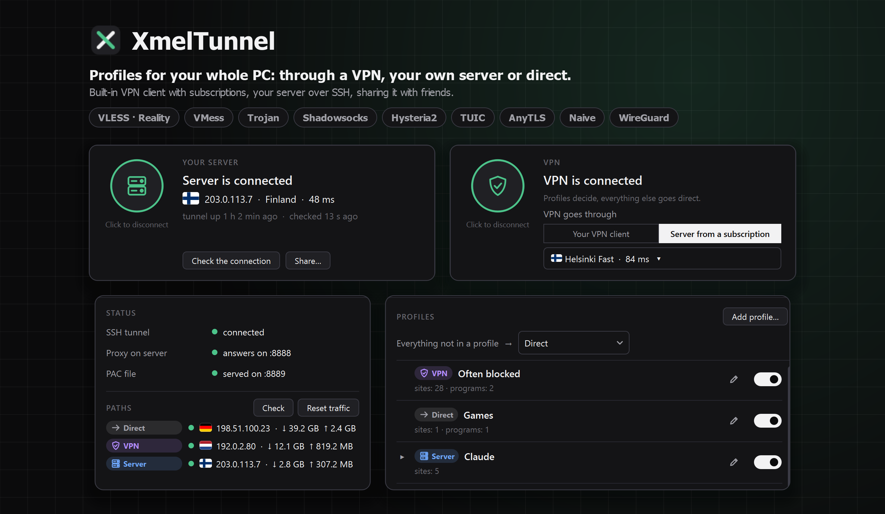
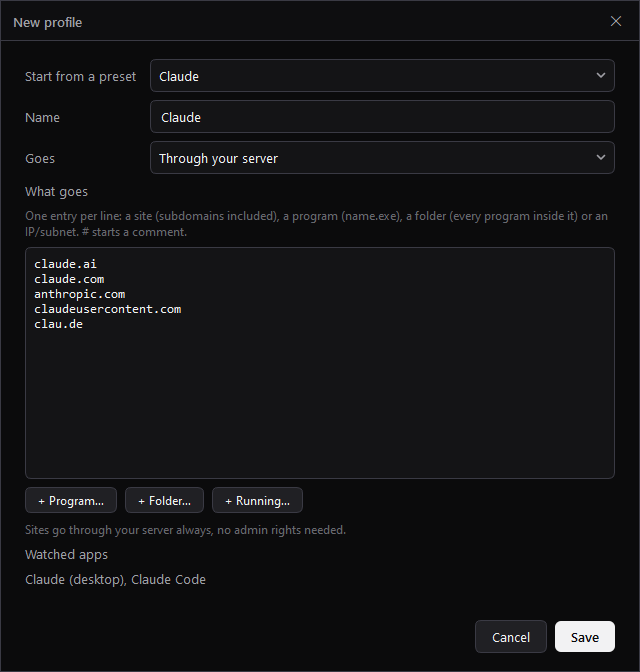
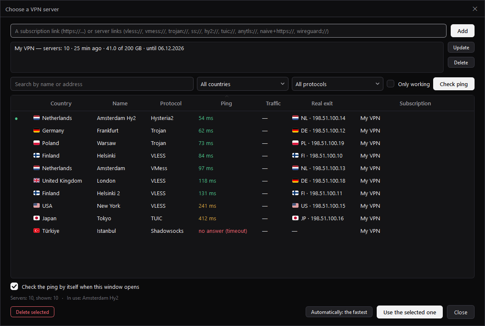

<p align="center"></p>

<p align="center">
  <a href="../../releases/latest"></a>
  <a href="LICENSE"></a>
  
  &nbsp;·&nbsp; <a href="README.ru.md">Русский</a>
</p>

XmelTunnel decides **how every program and every site** on your PC goes out: through a VPN, through your
own server, or direct. Games and banks direct, blocked sites through the VPN, work tools always from your
server's address. All at the same time.


## Why

A regular VPN pushes **all** traffic through itself. Games lag or ban you for "another country", banks
refuse to open, and you end up switching the VPN on and off all day.

XmelTunnel works the other way around: you write **profiles** (what goes where), and it keeps it that way:

- **through the VPN**: blocked sites and programs;
- **through your server**: things that should always see the same address, such as AI tools, dashboards
  and accounts tied to an IP;
- **direct**: games, banks, local services;
- everything not in a profile goes where you say.

## What it does

- **Built-in VPN client.** Subscriptions and server links: VLESS (Reality included), VMess, Trojan,
  Shadowsocks, Hysteria2, TUIC, AnyTLS, Naive and WireGuard. Servers it cannot use do not vanish silently:
  the subscription list says how many were skipped and why.
- **Honest ping.** Latency is a real request through the server, the same number Throne and other sing-box
  clients show, next to the **real exit country**: a server called "Germany" sometimes exits in the
  Netherlands. The fastest server can be picked automatically, also within one country.
- **Profiles for the whole PC.** A profile holds sites (with subdomains), programs (`Discord.exe`), folders
  (every program inside, handy for games) and subnets. Programs and folders are more reliable than sites:
  all their traffic goes, voice and game UDP included. Presets cover AI tools, often blocked sites and more.
- **Your server.** Over an SSH key (a tiny proxy, ~3 MB of RAM, is installed on it) or by a share link.
  No open ports: the proxy listens on `127.0.0.1` only and is reachable only through SSH.
- **Share with friends.** "Share…" gives a friend a personal link to your server: their own port and key,
  a traffic limit and an expiry date, usage counted. Friends cannot reach the server itself, your network
  or mail ports, so nobody sends spam from your address.
- **Traffic** per path and per server, received and sent separately.
- **On top of another VPN client.** If you already run a client in TUN mode (Happ, v2rayN and the like),
  XmelTunnel can send "through the VPN" into it and games and chosen apps around it.
- **One click** on the ring connects or disconnects. Extra clicks while it is switching are ignored.
- **Fails closed.** If the tunnel to your server is down, profile sites do not load; they never quietly go
  direct. It checks which address and country each path really exits with.
- **Updates itself** and shows what changed afterwards. Every file is checked by its checksum.
- Dark and light theme, English and Russian, lives in the tray.

| Profile editor | VPN servers |
|---|---|
|  |  |

## Install

Download from [Releases](../../releases/latest):

- **`XmelTunnel-Setup.exe`** (recommended). Installs for your user only, no admin rights. Adds a Start menu
  shortcut and appears in Windows *Installed apps*, so uninstalling cleans everything up.
- **`XmelTunnel.exe`** is a portable single file if you don't want to install anything.

**Antivirus and SmartScreen.** The exe is not code-signed yet, so Windows may show "Windows protected your
PC". Click *More info → Run anyway*. Every release file comes with a SHA-256 checksum. The installer is less
likely to trigger false positives than the portable file. If your antivirus flags it, please
[open an issue](../../issues).

## Quick start

The first launch opens "Quick start" (you can open it again from Settings). Start with what you have:

1. **A VPN subscription.** In the server window paste a subscription link (`https://…`) or server links,
   press "Check ping" and pick a server, or keep "Automatic: the fastest".
2. **Your server.** Enter its address (`1.2.3.4`, `user@host` or an alias from `~/.ssh/config`) and the key
   file, press "Check connection", then "Install proxy on the server". A server is optional: the VPN works
   without it.
3. **Profiles.** Press "Add profile…", pick a preset or type your own, and choose where it goes.

Then click the VPN ring. Windows asks for admin rights: they are needed for the virtual adapter that
sing-box routes traffic through. If the prompts bother you, Settings can allow connecting without them
through the Windows Task Scheduler.

## How to tell it really works

- The "Your server" and "VPN" rings are green.
- Under "Paths", each path shows its own exit address and country: "Direct" is your normal connection,
  "VPN" the VPN server's country, "Server" your server.
- In a browser, `https://www.cloudflare.com/cdn-cgi/trace` shows the address of the path that site takes by
  your profiles.

Note: if your server is blocked in your country, local services may not open through it either, since they
sit behind the same filters. Keep local things direct.

## What it changes on your PC

| What | Where | When |
|---|---|---|
| PAC URL | `HKCU\…\Internet Settings\AutoConfigURL` | while a "through your server" profile is on; the previous value is restored afterwards |
| Claude Code proxy | `env` block in `~/.claude/settings.json` | while a profile with Claude Code is on; only values it wrote itself are removed |
| Virtual adapter "XmelTunnel" and its routes | sing-box | only while the VPN is connected |
| Task "XmelTunnel Routing" | Windows Task Scheduler | only if you allowed connecting without the admin prompt |
| Autostart | `HKCU\…\Run\XmelTunnel` | only if you turn it on |
| Settings, log, sing-box | `%APPDATA%\XmelTunnel` | always |

sing-box is downloaded on the first connection from its official release page (about 33 MB), checked by
its checksum, and checked again before every elevated start.

## Uninstall

- **Installed with `XmelTunnel-Setup.exe`:** remove *XmelTunnel* in *Settings → Apps → Installed apps*. The
  uninstaller undoes what XmelTunnel changed: it puts your previous Windows proxy setting back, removes its
  Claude Code proxy and autostart, and deletes its settings and log.
- **Portable exe:** open **Settings → Remove from this PC…** (same cleanup), then delete `XmelTunnel.exe`.
  If you already deleted it, download it again and run `XmelTunnel.exe --uninstall`.

Your server is not touched. To remove the proxy there too, run `apt remove tinyproxy` (or your distro's
equivalent).

## Build from source

```powershell
python -m venv .venv
.venv\Scripts\pip install -r requirements.txt pyinstaller pytest
.venv\Scripts\python -m pytest -q tests
.venv\Scripts\python -m xmeltunnel     # run
.venv\Scripts\python build.py          # -> dist\XmelTunnel.exe, dist\XmelTunnel-Setup.exe (needs Inno Setup 6+)
```

What changed between versions is in [CHANGELOG.md](CHANGELOG.md) (in Russian).

## Responsible use

XmelTunnel routes traffic through servers **you** choose. You are responsible for following the terms of the
services you use and the laws that apply to you.

## License

[GPL v3](LICENSE). Flag icons come from [flag-icons](https://github.com/lipis/flag-icons) (MIT), the core is
[sing-box](https://github.com/SagerNet/sing-box) (GPL v3); see [THIRD-PARTY.md](THIRD-PARTY.md).
