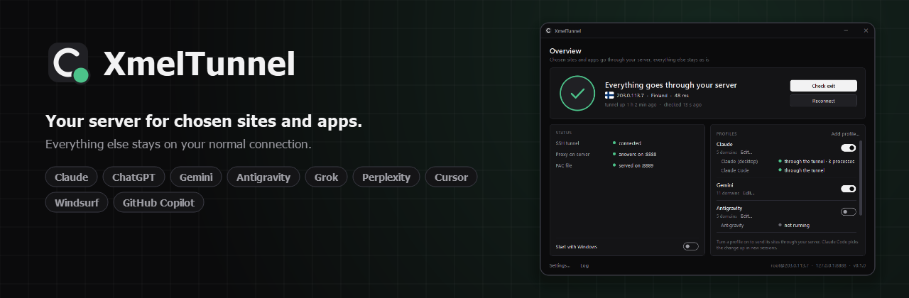
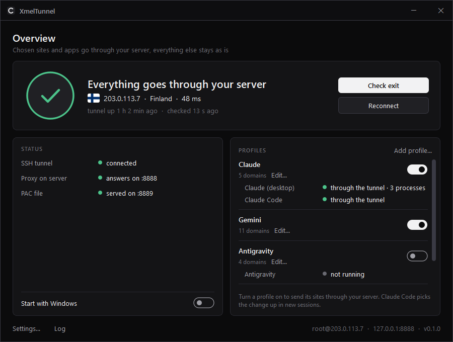
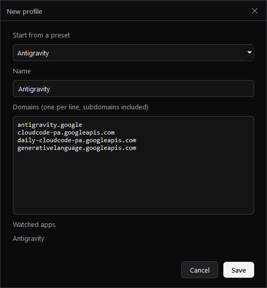
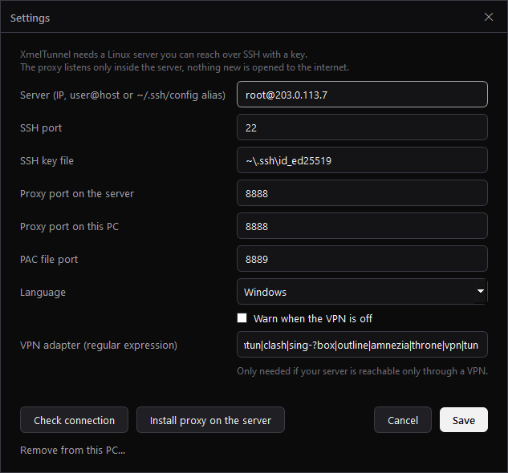

<p align="center"></p>

<p align="center">
  <a href="../../releases/latest"></a>
  <a href="LICENSE"></a>
  
  &nbsp;·&nbsp; <a href="README.ru.md">Русский</a>
</p>

Send chosen sites and apps through **your own server** over SSH. Everything else stays on your normal connection.



## Why

A full VPN moves *all* traffic. Sometimes you only want a few services to always see the same IP, the IP of a server you own, while the rest of your traffic stays where it is:

- web apps that tie your session or account to an IP address;
- dashboards and APIs behind an IP allowlist;
- AI tools you use every day and want to reach from one stable address;
- any site you would rather open from your server's location.

XmelTunnel does exactly that and **checks that it actually works**. It doesn't just set a proxy and hope.

## What it does

- **SSH tunnel to your server.** It keeps the tunnel up and reconnects when it drops. No VPN protocol, no open ports: the proxy on the server listens on `127.0.0.1` and is reachable only through SSH with your key.
- **One-click server setup.** It installs a tiny proxy (tinyproxy, ~3 MB RAM) over SSH. Tested on Debian, Ubuntu, Alpine and Rocky/RHEL.
- **Profiles.** A profile is a list of domains that go through the tunnel. Turn profiles on and off with a switch. Presets are included for Claude, ChatGPT, Gemini, Antigravity, Grok, Perplexity, Cursor, Windsurf and GitHub Copilot. You can also add your own list.
- **Per-app routing without a VPN.** A PAC file sends only the profile's domains through the tunnel. Browsers and desktop apps that follow Windows proxy settings (Chrome, Edge, Electron apps) pick it up. Claude Code gets its proxy through `~/.claude/settings.json`.
- **Fails closed.** If the tunnel is down, profile sites do not load. They never quietly go direct.
- **Survives VPN clients.** Many VPN apps reset the Windows proxy settings when they disconnect. While a profile is on, XmelTunnel notices it and puts its PAC back.
- **Leak watching.** For apps in a profile, XmelTunnel looks at their real TCP connections. It shows whether each app goes *through the tunnel* or *directly, around it*.
- **Exit check.** It asks Cloudflare which IP and country it sees through the tunnel and compares the answer with your server.
- **Notifications.** You get one when a watched app starts while the tunnel is down, when an app leaks around the tunnel, or when your VPN is off (optional, for servers reachable only through a VPN).
- **Tray app.** A dark or light UI follows Windows. English and Russian.

| Profile editor | Settings |
|---|---|
|  |  |

## Requirements

- Windows 10/11 with the built-in OpenSSH client. It is installed by default; check with `ssh -V`.
- A Linux server (any cheap VPS) that you can log into with an SSH **key**.

If you log in with a password today, add your key once:

```powershell
ssh-keygen -t ed25519            # only if you have no key yet
type $env:USERPROFILE\.ssh\id_ed25519.pub | ssh root@YOUR_SERVER "mkdir -p ~/.ssh && cat >> ~/.ssh/authorized_keys"
```

## Install

Download from [Releases](../../releases/latest):

- **`XmelTunnel-Setup.exe`** (recommended). Installs for your user only, no admin rights. Adds a Start menu shortcut and appears in Windows *Installed apps*, so uninstalling cleans everything up.
- **`XmelTunnel.exe`** is a portable single file if you don't want to install anything.

Then:

1. Run it. Settings open on the first launch.
2. Enter your server (`1.2.3.4`, `user@host` or an alias from `~/.ssh/config`) and the key file.
3. Click **Check connection**, then **Install proxy on the server**.
4. Click **Save**, then turn on the profiles you need.
5. Optional: turn on **Start with Windows**.

Restart the apps you want to route. Claude Code picks up its proxy in new sessions.

**Antivirus and SmartScreen.** The exe is not code-signed yet, so Windows may show "Windows protected your PC". Click *More info → Run anyway*. Every release is built by GitHub Actions from this repository and comes with a SHA-256 checksum. The installer version is less likely to trigger false positives than the portable one. If your antivirus flags it, please [open an issue](../../issues).

## How to tell it really works

- The ring is green, and the exit line shows your server's IP and country.
- Each watched app says **through the tunnel**.
- In a browser, `https://claude.ai/cdn-cgi/trace` (or any Cloudflare site in your profile) shows `ip=` equal to your server. `https://www.cloudflare.com/cdn-cgi/trace` shows your normal IP, because that site is not in a profile.

## What it changes on your PC

| What | Where | When |
|---|---|---|
| PAC URL | `HKCU\…\Internet Settings\AutoConfigURL` | while at least one profile is on. Your previous PAC URL is restored when you turn them all off |
| Claude Code proxy | `env` block in `~/.claude/settings.json` | while a profile with Claude Code is on. Only values it wrote itself are removed |
| Autostart | `HKCU\…\Run\XmelTunnel` | only if you turn it on |
| Config and log | `%APPDATA%\XmelTunnel` | always |

Nothing is installed system-wide, and no admin rights are needed.

While XmelTunnel is closed, nothing serves the PAC file and Windows falls back to direct connections. Keep it running, or turn profiles off before quitting.

## Uninstall

- **Installed with `XmelTunnel-Setup.exe`:** remove *XmelTunnel* in Windows *Settings → Apps → Installed apps*. The uninstaller undoes everything XmelTunnel changed: it puts your previous Windows proxy (PAC) setting back, removes its Claude Code proxy, turns off autostart, and deletes its settings and log.
- **Portable exe:** open **Settings… → Remove from this PC…** (same cleanup), then delete `XmelTunnel.exe`. If you already deleted it, download it again and run `XmelTunnel.exe --uninstall`.

Your server is not touched. To remove the proxy there too, run `apt remove tinyproxy` (or your distro's equivalent).

## Build from source

```powershell
python -m venv .venv
.venv\Scripts\pip install -r requirements.txt pyinstaller pytest
.venv\Scripts\python -m pytest -q tests
.venv\Scripts\python -m xmeltunnel     # run
.venv\Scripts\python build.py          # -> dist\XmelTunnel.exe, dist\XmelTunnel-Setup.exe (needs Inno Setup 6+)
```

## Responsible use

XmelTunnel routes traffic through a server **you** control. You are responsible for following the terms of the services you use and the laws that apply to you.

## License

[GPL v3](LICENSE). Flag icons come from [flag-icons](https://github.com/lipis/flag-icons) (MIT); see [THIRD-PARTY.md](THIRD-PARTY.md).
