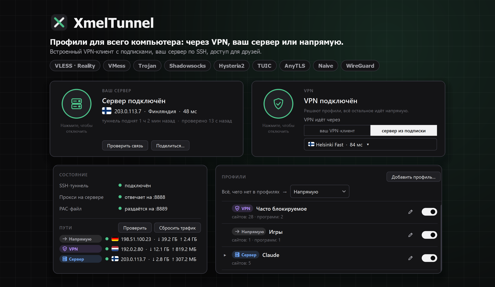
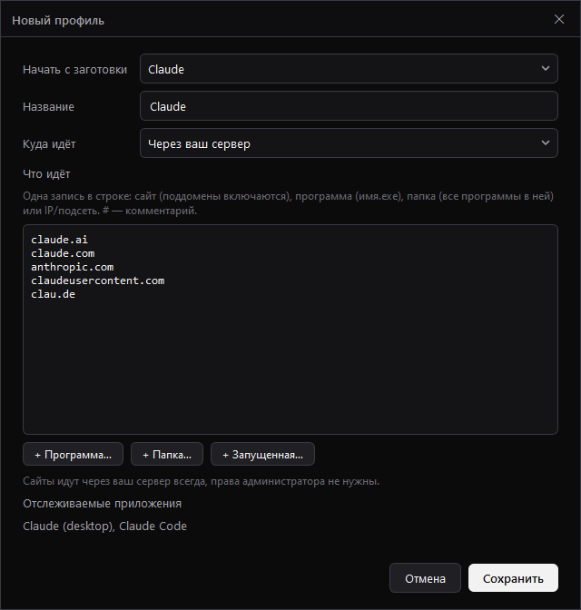
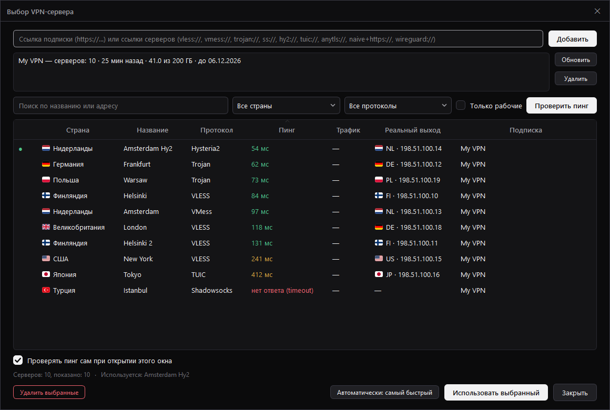

<p align="center"></p>

<p align="center">
  <a href="../../releases/latest"></a>
  <a href="LICENSE"></a>
  
  &nbsp;·&nbsp; <a href="README.md">English</a>
</p>

XmelTunnel решает, **как идёт каждая программа и каждый сайт** на вашем компьютере: через VPN, через ваш
собственный сервер или напрямую. Игры и банки — напрямую, заблокированное — через VPN, рабочие сервисы —
всегда с одного адреса вашего сервера. И всё это одновременно.


## Зачем

Обычный VPN гонит через себя **весь** трафик. Отсюда знакомые проблемы: игры лагают и банят за «другую
страну», банки и госуслуги не открываются, а включать и выключать VPN приходится по сто раз на дню.

XmelTunnel работает иначе: вы составляете **профили** — что куда должно идти, — а программа следит, чтобы
так и было:

- **через VPN** — заблокированные сайты и программы;
- **через ваш сервер** — то, что должно всегда видеть один и тот же адрес: ИИ-сервисы, рабочие панели,
  аккаунты, привязанные к IP;
- **напрямую** — игры, банки, местные сервисы;
- всё, чего нет в профилях, идёт туда, куда вы скажете.

## Что умеет

- **Встроенный VPN-клиент.** Подписки и ссылки серверов: VLESS (в том числе Reality), VMess, Trojan,
  Shadowsocks, Hysteria2, TUIC, AnyTLS, Naive и WireGuard. Серверы, которые программа разобрать не смогла,
  не пропадают молча: в списке подписок видно, сколько их и почему.
- **Честный пинг.** Задержка меряется настоящим запросом через сервер — те же числа, что в Throne и других
  клиентах на sing-box. Рядом — **реальная страна выхода**: бывает, что «Германия» в названии выходит в
  интернет из Нидерландов. Можно включить автовыбор самого быстрого сервера, в том числе в одной стране.
- **Профили для всего компьютера.** В профиле — сайты (с поддоменами), программы (`Discord.exe`), папки
  (все программы внутри — удобно для игр), подсети и готовые списки. Программы и папки надёжнее сайтов: идёт весь их
  трафик, включая голос и UDP в играх. Есть готовые заготовки: ИИ-сервисы, часто блокируемое и другие.
- **Ваш сервер.** Подключение по SSH-ключу (на сервер ставится крошечный прокси, ~3 МБ памяти) или по
  ссылке сервера. Без открытых портов: прокси слушает только `127.0.0.1` и доступен лишь через SSH.
- **Доступ для друзей.** Кнопка «Поделиться…» выдаёт другу личную ссылку на ваш сервер: свой порт и ключ,
  лимит трафика и срок, учёт израсходованного. Друзьям закрыты сам сервер, ваша сеть и почтовые порты —
  чтобы с вашего адреса никто не слал спам.
- **Готовые списки**, которые обновляются сами: «Заблокированное в России», «Российские сайты»,
  «Реклама и трекеры» и другие. «Заблокированное — через VPN, остальное — напрямую» — одним кликом.
- **Блокировка.** Цель «Заблокировать»: реклама, трекеры и телеметрия не уходят с компьютера вообще.
- **Окно «Подключения»:** какая программа и какой сайт куда идут прямо сейчас и почему. Любую строку
  можно сразу добавить в профиль.
- **Свой DNS:** DNS over HTTPS для прямых сайтов (Cloudflare, Google, Quad9, AdGuard или свой) с
  автоматической заменой, если сервер не отвечает, и отдельный DNS для сайтов через VPN.
- **Трафик** по каждому пути и каждому серверу, отдельно полученный и отправленный.
- **Поверх другого VPN-клиента.** Если у вас уже есть клиент в режиме TUN (Happ, v2rayN и подобные),
  XmelTunnel может отправлять «через VPN» в него, а игры и выбранное — мимо него.
- **Подключение одним нажатием** на круг. Пока идёт переключение, лишние нажатия не принимаются.
- **Не протекает.** Если туннель до сервера упал, сайты профиля не открываются, а не уходят тихо напрямую.
  Программа сама проверяет, с какого адреса и из какой страны вы на самом деле выходите на каждом пути.
- **Сама обновляется**, а после обновления показывает, что изменилось. Каждый файл проверяется по
  контрольной сумме.
- Тёмная и светлая тема, русский и английский язык, работа из трея.

| Редактор профиля | Выбор VPN-сервера |
|---|---|
|  |  |

## Установка

Скачайте со страницы [релизов](../../releases/latest):

- **`XmelTunnel-Setup.exe`** — рекомендуется. Ставится только для вашего пользователя, права администратора
  не нужны. Появляется в меню «Пуск» и в «Установленных приложениях» Windows и удаляется оттуда же начисто.
- **`XmelTunnel.exe`** — переносная версия одним файлом, если ничего ставить не хочется.

**Антивирус и SmartScreen.** У программы пока нет цифровой подписи, поэтому Windows может показать
«Система Windows защитила ваш компьютер». Нажмите «Подробнее» → «Выполнить в любом случае». У каждого файла
в релизе есть контрольная сумма SHA-256. Установщик реже вызывает ложные срабатывания, чем переносная
версия. Если антивирус ругается, [напишите об этом](../../issues).

## Быстрый старт

При первом запуске откроется окно «Быстрый старт»; потом его можно открыть снова в настройках. Начните с
того, что у вас есть:

1. **Подписка VPN.** В окне выбора сервера вставьте ссылку подписки (`https://…`) или ссылки серверов,
   нажмите «Проверить пинг» и выберите сервер — или оставьте «Автоматически: самый быстрый».
2. **Ваш сервер.** Укажите адрес (`1.2.3.4`, `user@host` или имя из `~/.ssh/config`) и файл ключа, нажмите
   «Проверить связь», затем «Установить прокси на сервер». Сервер необязателен: VPN работает и без него.
3. **Профили.** Нажмите «Добавить профиль…», выберите заготовку или впишите своё и укажите, куда это
   должно идти.

Потом нажмите на круг «VPN». Windows спросит права администратора: они нужны, чтобы создать виртуальный
адаптер, через который sing-box распределяет трафик. Если эти запросы мешают, в настройках можно разрешить
подключение без них — через планировщик заданий Windows.

## Как понять, что всё работает

- Круги «Ваш сервер» и «VPN» зелёные.
- В блоке «Пути» у каждого пути — свой адрес и страна: «Напрямую» — ваш обычный интернет, «VPN» — страна
  VPN-сервера, «Сервер» — ваш сервер.
- В браузере `https://www.cloudflare.com/cdn-cgi/trace` показывает адрес того пути, куда этот сайт
  попадает по вашим профилям.

Учтите: если ваш сервер заблокирован в вашей стране, местные сервисы через него тоже могут не открыться —
они стоят за теми же фильтрами. Местное лучше пускать напрямую.

## Что программа меняет на компьютере

| Что | Где | Когда |
|---|---|---|
| Адрес PAC-файла | `HKCU\…\Internet Settings\AutoConfigURL` | пока включён профиль «через ваш сервер»; потом возвращается прежнее значение |
| Прокси для Claude Code | блок `env` в `~/.claude/settings.json` | пока включён профиль с Claude Code; удаляется только то, что программа записала сама |
| Виртуальный адаптер «XmelTunnel» и его маршруты | sing-box | только пока VPN подключён |
| Задание «XmelTunnel Routing» | планировщик заданий Windows | только если вы разрешили подключение без запроса прав |
| Автозапуск | `HKCU\…\Run\XmelTunnel` | только если вы его включили |
| Настройки, журнал, sing-box | `%APPDATA%\XmelTunnel` | всегда |

sing-box скачивается при первом подключении с его официальной страницы релизов (около 33 МБ), проверяется
по контрольной сумме и проверяется ещё раз перед каждым запуском с правами администратора.

## Удаление

- **Установлено через `XmelTunnel-Setup.exe`:** удалите *XmelTunnel* в «Параметры → Приложения →
  Установленные приложения». Деинсталлятор отменяет то, что меняла программа: возвращает прежнюю настройку
  прокси Windows, убирает прокси Claude Code и автозапуск, удаляет настройки и журнал.
- **Переносная версия:** «Настройки → Удалить с этого ПК…» (та же уборка), затем удалите `XmelTunnel.exe`.
  Если файл уже удалён, скачайте его снова и запустите `XmelTunnel.exe --uninstall`.

Ваш сервер программа не трогает. Чтобы убрать прокси и там, выполните `apt remove tinyproxy` (или аналог
для вашего дистрибутива).

## Сборка из исходников

```powershell
python -m venv .venv
.venv\Scripts\pip install -r requirements.txt pyinstaller pytest
.venv\Scripts\python -m pytest -q tests
.venv\Scripts\python -m xmeltunnel     # запуск
.venv\Scripts\python build.py          # -> dist\XmelTunnel.exe, dist\XmelTunnel-Setup.exe (нужен Inno Setup 6+)
```

Что менялось от версии к версии — в [CHANGELOG.md](CHANGELOG.md).

## Ответственное использование

XmelTunnel направляет трафик через серверы, которые выбираете **вы**. Соблюдать условия сервисов, которыми
вы пользуетесь, и законы вашей страны — ваша ответственность.

## Лицензия

[GPL v3](LICENSE). Флаги — из [flag-icons](https://github.com/lipis/flag-icons) (MIT), ядро —
[sing-box](https://github.com/SagerNet/sing-box) (GPL v3); подробности в [THIRD-PARTY.md](THIRD-PARTY.md).
