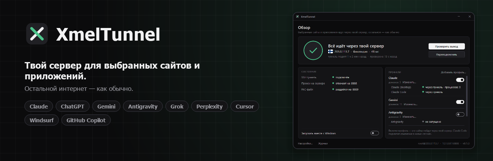
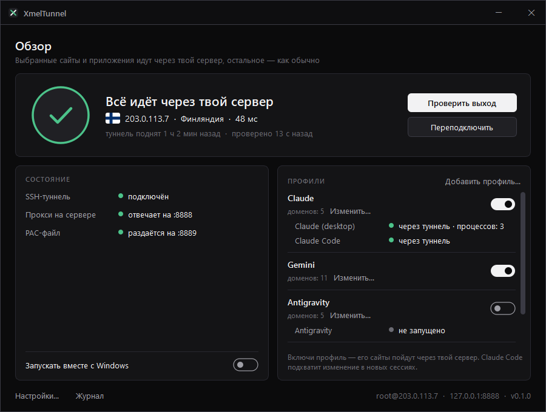

<p align="center"></p>

<p align="center">
  <a href="../../releases/latest"></a>
  <a href="LICENSE"></a>
  
  &nbsp;·&nbsp; <a href="README.md">English</a>
</p>

Выбранные сайты и приложения идут через **твой сервер** по SSH. Остальной интернет — как обычно.



## Зачем

VPN переносит *весь* трафик. Иногда нужно, чтобы только несколько сервисов всегда видели один и тот же IP — IP твоего сервера, а остальное шло как раньше:

- сервисы, которые привязывают сессию или аккаунт к IP;
- панели и API за белым списком адресов;
- ИИ-инструменты, которыми пользуешься каждый день и хочешь заходить с одного постоянного адреса;
- любые сайты, которые удобнее открывать из страны сервера.

XmelTunnel делает именно это и **проверяет, что всё действительно работает**, а не просто прописывает прокси в надежде на лучшее.

## Что умеет

- **SSH-туннель до сервера.**
  - Держит туннель и переподключается при обрыве.
  - Никакого VPN-протокола и открытых портов: прокси на сервере слушает только `127.0.0.1`, попасть к нему можно лишь по SSH с твоим ключом.
- **Настройка сервера в одно нажатие.**
  - Ставит по SSH маленький прокси tinyproxy, около 3 МБ памяти.
  - Проверено на Debian, Ubuntu, Alpine и Rocky/RHEL.
- **Профили.**
  - Профиль — это список доменов, которые идут через туннель. Каждый включается переключателем.
  - Есть заготовки: Claude, ChatGPT, Gemini, Antigravity, Grok, Perplexity, Cursor, Windsurf, GitHub Copilot. Можно добавить свой список.
- **Отдельные приложения без VPN.**
  - PAC-файл отправляет в туннель только домены профилей.
  - Его подхватывают браузеры и приложения, которые следуют настройкам прокси Windows: Chrome, Edge, приложения на Electron.
  - Claude Code получает прокси через `~/.claude/settings.json`.
- **Без тихой утечки.** Если туннель упал, сайты профиля не открываются, а не уходят молча напрямую.
- **Не боится VPN-клиентов.** Многие VPN-приложения при отключении сбрасывают настройки прокси Windows. Пока профиль включён, XmelTunnel замечает это и возвращает свой PAC.
- **Проверка утечек.** Для приложений из профиля XmelTunnel смотрит их реальные TCP-соединения и показывает, идёт ли каждое *через туннель* или *напрямую, мимо него*.
- **Проверка выхода.** Спрашивает у Cloudflare, какой IP и страну тот видит через туннель, и сверяет с твоим сервером.
- **Уведомления.** Приходят в трех случаях:
  - отслеживаемое приложение запустилось, а туннель лежит;
  - приложение идёт мимо туннеля;
  - выключен VPN — по желанию, для серверов, доступных только через VPN.
- **Программа в трее.** Тёмная или светлая тема по настройке Windows, английский и русский интерфейс.

## Что нужно

- Windows 10/11 со встроенным клиентом OpenSSH. Он есть по умолчанию, проверить можно командой `ssh -V`.
- Linux-сервер, подойдёт любой недорогой VPS, на который ты заходишь по SSH-**ключу**.

Если сейчас заходишь по паролю, один раз добавь ключ:

```powershell
ssh-keygen -t ed25519            # только если ключа ещё нет
type $env:USERPROFILE\.ssh\id_ed25519.pub | ssh root@ТВОЙ_СЕРВЕР "mkdir -p ~/.ssh && cat >> ~/.ssh/authorized_keys"
```

## Установка

1. Скачай `XmelTunnel.exe` из [Releases](../../releases). Это один файл, установка не нужна.
2. Запусти. При первом запуске откроются настройки.
3. Впиши сервер (`1.2.3.4`, `user@host` или алиас из `~/.ssh/config`) и файл ключа.
4. Нажми «Проверить связь», затем «Установить прокси на сервер».
5. Нажми «Сохранить» и включи нужные профили.
6. По желанию включи «Запускать вместе с Windows».

Перезапусти приложения, которые должны идти через туннель. Claude Code подхватывает прокси в новых сессиях.

## Как понять, что работает

- Кольцо зелёное, в строке выхода IP и страна твоего сервера.
- У каждого отслеживаемого приложения написано «через туннель».
- В браузере `https://claude.ai/cdn-cgi/trace` (или любой сайт на Cloudflare из профиля) показывает `ip=` твоего сервера. А `https://www.cloudflare.com/cdn-cgi/trace` показывает твой обычный IP: этого сайта нет в профилях.

## Что программа меняет на ПК

| Что | Где | Когда |
|---|---|---|
| Адрес PAC | `HKCU\…\Internet Settings\AutoConfigURL` | пока включён хотя бы один профиль; прежний адрес PAC возвращается, когда все выключены |
| Прокси Claude Code | блок `env` в `~/.claude/settings.json` | пока включён профиль с Claude Code; удаляются только значения, которые программа записала сама |
| Автозапуск | `HKCU\…\Run\XmelTunnel` | только если включишь |
| Настройки и журнал | `%APPDATA%\XmelTunnel` | всегда |

Ничего не ставится в систему, права администратора не нужны.

Пока XmelTunnel закрыт, PAC-файл никто не раздаёт, и Windows пускает трафик напрямую. Держи программу запущенной или выключай профили перед выходом.

## Удаление

XmelTunnel — это один exe-файл без установщика. Чтобы удалить его начисто:

1. Открой «Настройки…» и нажми «Удалить с этого ПК…». Программа сама:
   - вернёт прежние настройки прокси (PAC) в Windows;
   - уберёт свой прокси из настроек Claude Code;
   - выключит автозапуск;
   - удалит свои настройки и журнал;
   - закроется.
2. Удали `XmelTunnel.exe`.

Если exe уже удалён, скачай его заново и запусти `XmelTunnel.exe --uninstall`. Сервер при этом не трогается. Чтобы убрать прокси и с него, выполни там `apt remove tinyproxy` или аналог для своего дистрибутива.

## Сборка из исходников

```powershell
python -m venv .venv
.venv\Scripts\pip install -r requirements.txt pyinstaller pytest
.venv\Scripts\python -m pytest -q tests
.venv\Scripts\python -m xmeltunnel          # запуск
.venv\Scripts\pyinstaller XmelTunnel.spec    # -> dist\XmelTunnel.exe
```

## Ответственное использование

XmelTunnel пускает трафик через сервер, которым управляешь **ты**. Соблюдать условия сервисов, которыми ты пользуешься, и законы, которые к тебе применимы, — твоя ответственность.

## Лицензия

[GPL v3](LICENSE). Флаги взяты из [flag-icons](https://github.com/lipis/flag-icons) (MIT), подробнее — в [THIRD-PARTY.md](THIRD-PARTY.md).
